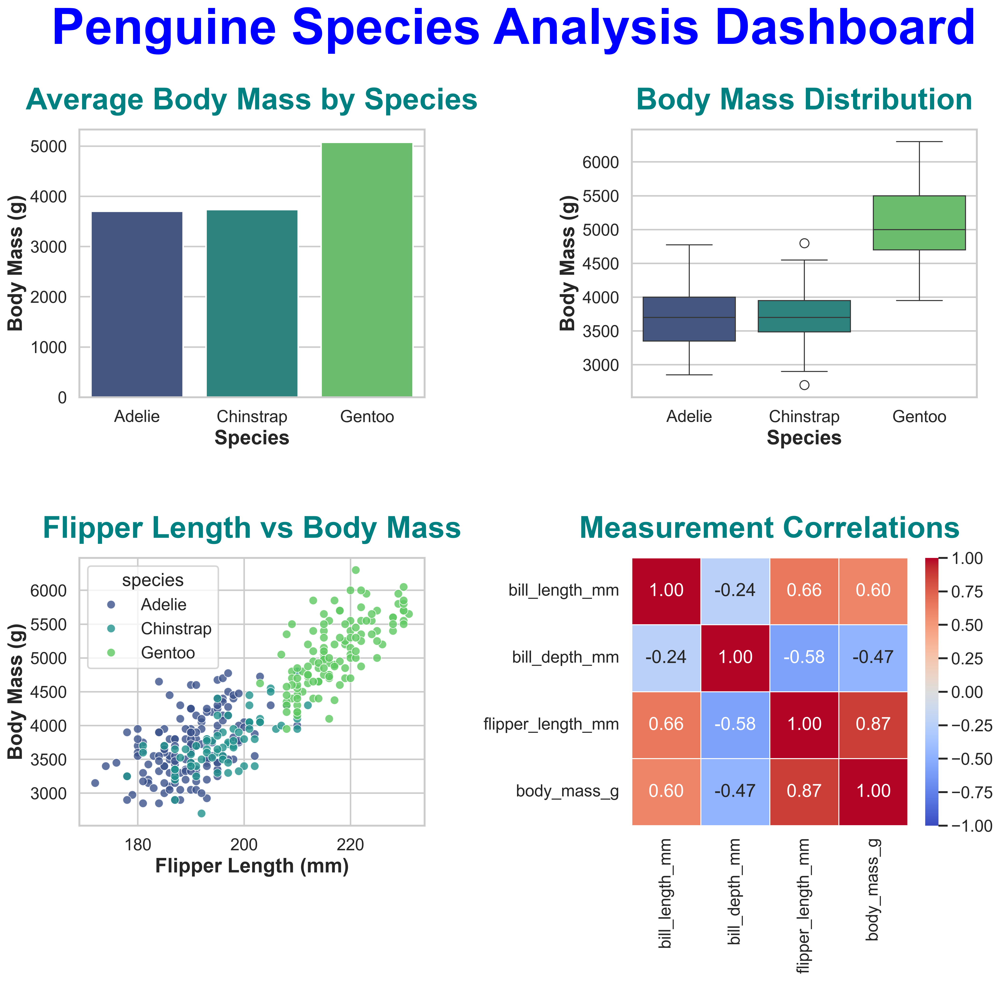

# Penguin Species Analysis 🐧

## Overview

This project performs Exploratory Data Analysis (EDA) on the Palmer Penguins dataset using Python, Pandas, Matplotlib, and Seaborn.

The goal is to explore differences among Adelie, Chinstrap, and Gentoo penguins by analyzing their physical measurements and visualizing relationships between numerical features.

## Objectives

- Load and inspect a real-world dataset.
- Identify and handle missing values.
- Compare physical measurements across penguin species.
- Explore relationships between flipper length, body mass, and bill measurements.
- Visualize correlations between numerical variables.
- Build a multi-plot analysis dashboard.

## Dataset

The dataset is loaded directly from Seaborn using `sns.load_dataset("penguins")`.

It contains 344 observations and 7 columns:

| Column | Description |
|---|---|
| `species` | Penguin species |
| `island` | Island where the penguin was observed |
| `bill_length_mm` | Bill length in millimeters |
| `bill_depth_mm` | Bill depth in millimeters |
| `flipper_length_mm` | Flipper length in millimeters |
| `body_mass_g` | Body mass in grams |
| `sex` | Recorded sex of the penguin |

Two observations with missing values in the required measurement columns were excluded from the cleaned analysis dataset, leaving 342 rows.

## Technologies Used

- Python
- Pandas
- NumPy
- Matplotlib
- Seaborn
- Jupyter Notebook

## Project Structure

```text
penguin-species-analysis/
├── penguin_analysis.ipynb
├── README.md
└── images/
    └── penguin_dashboard.png
```

## Analysis Performed

### 1. Data Inspection and Cleaning
- Inspected the dataset's dimensions, columns, and data types.
- Counted missing values and visualized their distribution.
- Examined duplicate rows.
- Created a cleaned dataset for analyses requiring complete physical measurements.

### 2. Exploratory Data Analysis
- Calculated average physical measurements for each species.
- Compared body mass and flipper length across species.
- Examined variation in body mass using boxplots.
- Explored relationships between flipper length and body mass using scatterplots.

### 3. Correlation Analysis
- Calculated the correlation matrix for numerical features.
- Visualized correlations using a heatmap.
- Examined the strength and direction of relationships between measurements.

### 4. Visualization Dashboard
The final dashboard combines four plots:

1. Average body mass by species.
2. Body mass distribution by species.
3. Flipper length versus body mass.
4. Correlation heatmap of numerical measurements.

## Dashboard



## Key Findings

- **Body mass:** Gentoo penguins have the highest average body mass, approximately 5,076 g.
- **Flipper length:** Gentoo penguins have the longest average flippers, approximately 217.19 mm.
- **Bill length:** Chinstrap penguins have the longest average bill length, approximately 48.83 mm.
- **Bill depth:** Gentoo penguins have the smallest average bill depth, approximately 14.98 mm.
- **Flipper length and body mass:** These variables have a strong positive correlation of approximately +0.871 in the cleaned dataset.
- **Species differences:** The visualizations reveal differences in both average measurements and individual variation among species.

These findings describe the observations in this dataset and do not establish causal relationships.

## How to Run the Project

1. Clone or download this repository.
2. Install the required libraries:

   ```bash
   pip install pandas numpy matplotlib seaborn jupyter
   ```

3. Start Jupyter Notebook:

   ```bash
   jupyter notebook
   ```

4. Open `penguin_analysis.ipynb`.
5. Run the cells from top to bottom.

An internet connection may be required the first time Seaborn downloads the built-in dataset.

## Conclusion

This project demonstrates how Python visualization libraries can be used to clean, explore, and analyze a real-world dataset. Pandas supports data preparation and statistical summaries, while Seaborn and Matplotlib help reveal patterns and communicate findings effectively.

The analysis highlights differences among penguin species and a strong positive association between flipper length and body mass.

---

*Project created for Python data analysis and visualization practice.*
